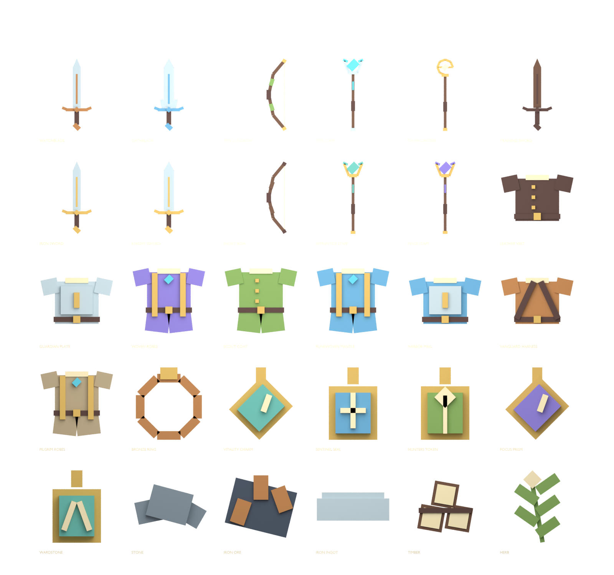

# Original inventory display kit

## Ore and timber refinement — 2026-10-20

The subsequent native gallery review found ore too close to stone and timber
ends too gear-like. Only `iron_ore` and `timber` are revised in this follow-up:
ore has a darker narrow host and broad exposed silver veins; two bundled timber
logs use convex hexagonal bodies instead of overlapping rotated square prisms.
The kit now has 272 parts across 30 items (ore 8, timber 15). The other 28
definitions, entire palette and constructor are unchanged from `e34a2e7`.

Local evidence is in `assets/production/ui-slice/material-refinement-v9` and
`production/ux/gameplay-quality/material_refinement_probe.py`. Native Studio
retake and human art review are pending for this follow-up. Historical native
gallery results and Blender exports do not validate these new shapes.

## Native material portrait revision — 2026-10-20

The generator, `kit.json`, and runtime `ItemVisuals.luau` now contain revised
stone, iron ore, iron ingot, timber, and herb geometry (276 parts across 30 items).
Rock facets, silver iron veins, sloped ingot shoulders, faceted timber ends and
pointed folded leaves target the existing 80×80 Inventory camera. Only native
Part/WedgePart shapes are used, at most 16 parts per item. The other 25 definitions,
their resolved colors, the runtime constructor and wearable integration are unchanged.

Local comparison evidence is generated directly from the source geometry by
`production/ux/gameplay-quality/material_portraits_probe.py`. Its software camera
approximation is not a Roblox Studio screenshot or acceptance result. Current
Studio visual testing and physical-device testing remain pending.

**Historical exports:** existing PNG, GLB, FBX, blend files, contact sheet and
export reports below have NOT been regenerated for these five materials. Do not
use their previous checks or part totals as validation of this revision. Runtime
geometry remains available without an upload; no new asset IDs were assigned.

## Historical export and integration evidence (before material revision)

All30 current item IDs have original low-poly display geometry:11weapons,8armor pieces,6accessories and5materials. Total246native parts or2912mesh triangles. No statistics, ownership, price or reward changes are included.

Each item has a512×512transparent RGBA icon, FBX and GLB. `Guildborne_Item_Kit.blend` contains an editable contact-sheet scene. `kit.json` is the shared Y-up/stud geometry source; individual export origins and sizes are preserved. These are display/prop meshes, not skinned wearable clothing or UGC-certified assets.

Rebuild: `tools/build_item_visuals.py`, then Blender `tools/blender_item_kit.py` with `--python-exit-code 1`. Verify with `tools/verify_item_kit.py` in Blender and `tools/audit_item_icons.py` in Python with Pillow. All60exports passed round-trip checks. All30icons passed RGBA/nonempty/transparent-margin checks; minimum51pixels of transparent padding. Reports include SHA256 hashes.

The Inventory uses `ItemViewport.luau` and the generated shared `ItemVisuals.luau`, so these previews already work without uploaded texture IDs. Maximum16parts/item; no scripts, Humanoids, animation or physical interaction. Imported atlas art, when configured and loaded, replaces the native preview visually; an absent or loading atlas retains the native fallback. Materials have compact preview/count rows.

Studio fixture `tests/studio_item_viewports_probe.luau` passed all30items/246parts, every part-corner inside the square camera frustum, unknown-ID handling and physics isolation. Mesh/texture upload, production import and physical-device performance remain pending. Source descriptions and account-binding labels remain visible beside previews.

Native wearable integration: `WardrobeVisuals.luau` now equips the8armor and6accessory designs on existing rigs. Shoulder pieces bind to arms, rings to hands, and pendants to the torso.28synthetic fit/weld/cleanup cases and8standard neutral R15 cases passed. These welded native shapes still require motion/clipping review across arbitrary avatar proportions; mesh exports are not skinned clothing.

