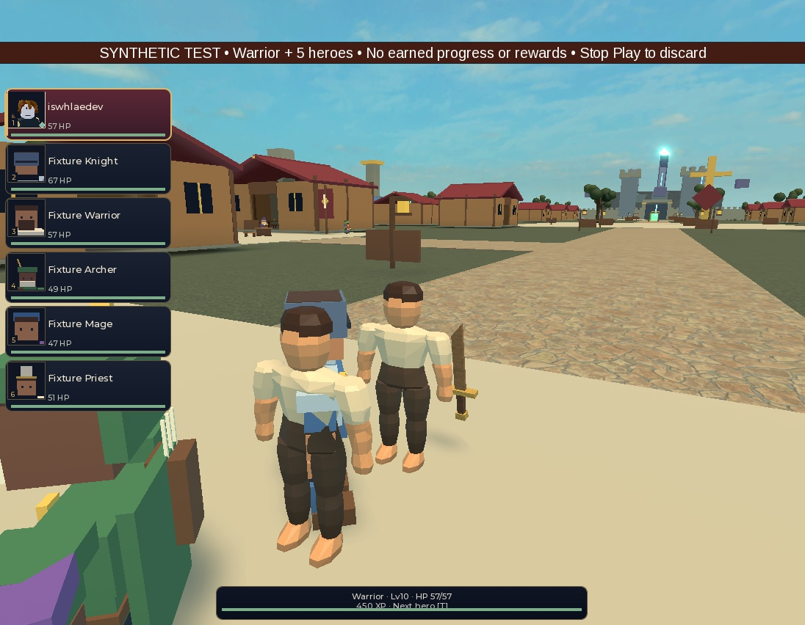
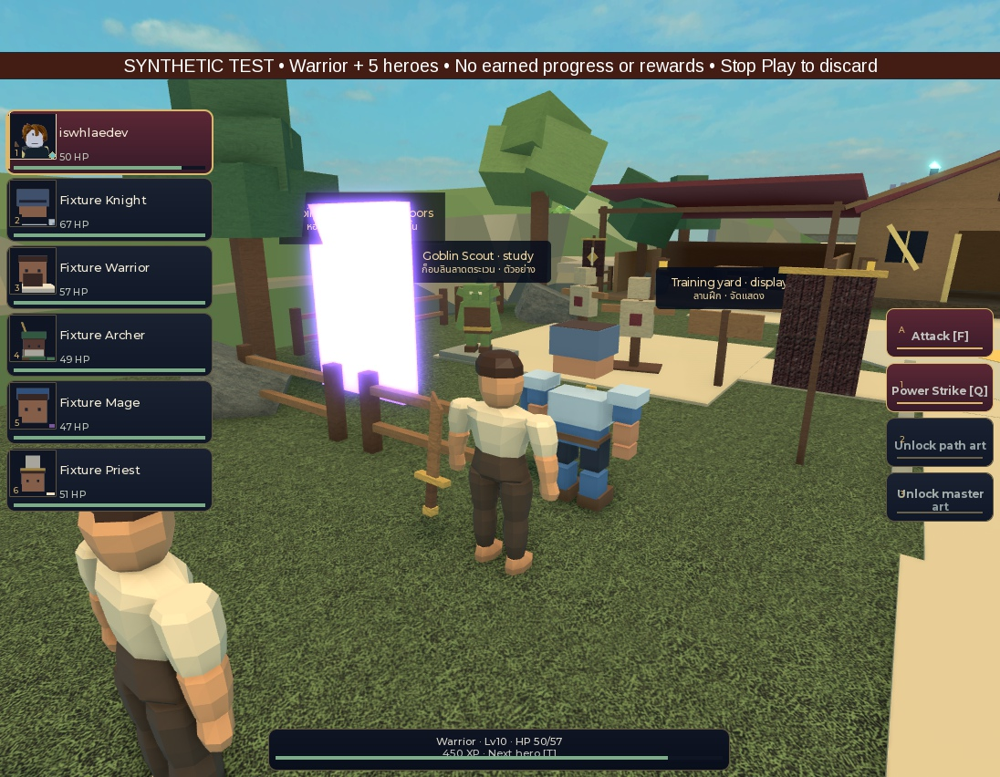

# Human Standard cosmetic restoration and weapon-contact inspection

Candidate `4e15b6ff6c2e9d65a7a5d07593a1af1043a53326`, following
`a0f0636ed54b6d9bf5232282552ca5ebc5f1d287`. This completes the bounded
cosmetic repair and performs the requested native contact inspection.
**Cosmetic visibility/restoration passed; weapon alignment and attack retargeting
failed.** The production renderer, creator/onboarding, saves, gender, other races
and art acceptance remain unchanged and incomplete.

## Source and native context

The controller exclusively used Studio
`f291dbaa-f592-422b-adc2-cf15a90e0173`, Guildborne_PartyPresentationLab,
PlaceId0/GameId0. It reused the existing three-road Memory fixture with disabled
normal bootstraps. `native/preflight.json` preserves both fixture scripts and
guards. This is a mixed synthetic fixture, not a full-current-HEAD game run.
Roster/class eligibility is synthetic; no earned profile is loaded.

The local adapter and new cosmetic helper plus two probe modules were installed
in Edit and read back before Play. Final normalized lengths/Adler32 match local
SHA256-attributed source fingerprints. The final stopped-Edit census also covers
the unchanged geometry, rig, garment partition, backing pool and skeleton.
The five native combat/equipment modules match current source fingerprints.
Generated Human Standard geometry remains the prior actual source candidate;
no asset was regenerated, imported, uploaded or assigned a runtime asset ID.

Historical filenames are preserved: `initial-install-readback.json` predates
the exact-Decal refinement, and `final-install-readback.json` belongs to the
first39-check candidate before RigidConstraint support. The actual final proof
is `final-native-readback.json` plus `final-edit-source-census.json`, matching
`candidate-source-fingerprints.json`. Do not substitute the historical installs
for those final fingerprints.

## Repair and actual result

`LocalLegacyCosmetics` identifies known body/costume parts through exact source
names, actor/template metadata and binding signatures. It preserves Equipped*
subtrees, Tools, item-tagged geometry, shields, weapon pieces and unknowns.
Recognized visibility is overridden locally and restored to its captured value
on detach, removal or eligibility changes. It never edits actor physics or gear.
The adapter remains unpublished-Studio/client-only and unused by the production
appearance renderer.

The first candidate passed39 synthetic policy assertions but failed actual
player-hair hiding: this avatar uses an enabled `AccessoryRigidConstraint`
between Handle.HairAttachment and Head.HairAttachment, with no AccessoryWeld.
That failure, structure readback and successful cleanup are retained. The repair
adds only that exact typed/named/end-point binding, in either direction.

Final native policy probe passed48 named assertions, including nonzero prior
visibility restoration, both Weld/RigidConstraint orientations, disabled/wrong
bindings, late/removed/reparented/renamed descendants, protected equipment,
unknown Texture preservation, idempotent cleanup and actor removal.

On the actual player,15 original body parts plus the original hair were hidden.
On the owner-matched Warrior hero,6 original body parts,13 direct costume details
and25 validated HeroAppearance parts were hidden. The hero is unarmed in this
fixture. The player uses the existing server-equipped `training_sword`; all5
pieces stayed visible. Both actors retained25 logical mesh references each on25
shared backing allocations.

Before and after movement/attack,22 original player parts and45 hero parts kept
the compared identity, parent, size, collision, massless, anchored and transparency
properties. The5 player and38 hero WeldConstraint bindings remained unchanged.
These new comparisons do not cover Motor6D bindings. Final detach immediately
restored all captured LTM/decal values with no comparison errors; handles,
logical resources, backing resources and pending resources all returned to0.
Play stopped; the owned Studio is in Edit.

This screenshot is newly captured from the repaired candidate. Other nearby
party members still use their original appearance. The faceless source body,
hair shape, garments and scene are not accepted final art.

## Walking and existing attack: failed contact gate

The player walked with its existing Humanoid.MoveTo to a nearby city point.
There are99 timestamped samples over5.963 seconds in ten raw pages. During this
window HP stayed57, logical references50 and backing allocations25. The authored
RightGripAttachment was outside the actual sword Grip's oriented bounding box
by **0.111–2.234 studs**; distance to its center was0.446–2.577 studs.

For the attack check, the controller relocated only the existing player as
explicit synthetic test setup, first outside camp at(-13,3.7,42), then3.5 studs
behind Goblin1. This is not route/travel proof. Five existing Hold commands were
accepted while companions were outside camp. A three-second server timer
returned the player to the setup position. Exactly one existing CombatIntent
`{action="Basic",actorId="player"}` was sent through the existing fixture handler.
The server accepted it, recorded BasicAttackCount1 and DamageDealt14.

There are129 client samples over3.492 seconds in thirteen raw pages. Of these,
31 fall0.036–0.870 seconds after the replicated ActionAt. In that action window:

- Source socket-to-Grip-box gap: **0.772–2.616 studs**.
- New preview right shoulder and elbow C0 maximum component change: **0**.
- Original hand world rotation changes by up to2.246 radians relative to the
  first action-window sample. The real weapon remains welded to that old hand.
- Blade/Point bounding-box distances to the recorded target point were sampled,
  but they are not target-surface collision or strike-contact acceptance.

The source confirms the adapter only drives cosmetic walking and does not read
ActionAt. Its authored hand/socket therefore does not follow the existing attack.
Damage is applied synchronously by existing combat code; the visual contact
timeline does not delay server damage. Do not claim that a successful command
or health change proves animation/weapon contact.

This fixture was **not isolated from companion AI**: Hold is not combat
suppression. One synthetic reward callback occurred, and Goblin1 was briefly
absent during a post-attack read before reappearing. The failed read is retained.
The callback only increments a counter; it grants nothing. Final report records
profileWrites0, and the client inspection models were absent on the server.
Do not attribute the whole encounter's damage or enemy lifecycle to the player's
single14-damage attack.

This second image was captured after the timed return, not at the strike contact
frame. No video was recorded. Timestamped raw samples provide bounded motion
telemetry, not visual animation acceptance or physical-device evidence.

## Checks and next owner

Full baseline on unchanged final4e15b6f passed973 tests,399 strict runtime files,
compile/analysis, Rojo build/sourcemap and repository checks. Receipt
`d1e6e0a17cba448aa1a797ea1b6208a4` ran89.175 seconds and exited0.
Earlier candidate receipt83819188535c43b5a84c8965eeaf47c8 is also retained.
Existing GUI harness warnings remain in unchanged stderr; this is not a
warning-free or Studio/device acceptance claim. Independent source review
approved the final helper/adapter/probes before native testing.

Next bounded implementation: Controller/S15 reconcile a source-derived
presentation-only weapon binding and server-approved action retargeting for the
same player/hero adapter. Preserve original authoritative equipment, actor
physics, combat timing and cleanup. Retest socket contact through walking and
the existing attack before connecting the production renderer/creator path.
Do not broaden gender/race/save rollout on the basis of this local repair.

Manifest covers63 unchanged raw/derived evidence files,1532966 bytes, excluding
this README, manifest and .gitattributes. Evidence is REVIEW-only until separately
reviewed and never substitutes for human art or release signoff.
