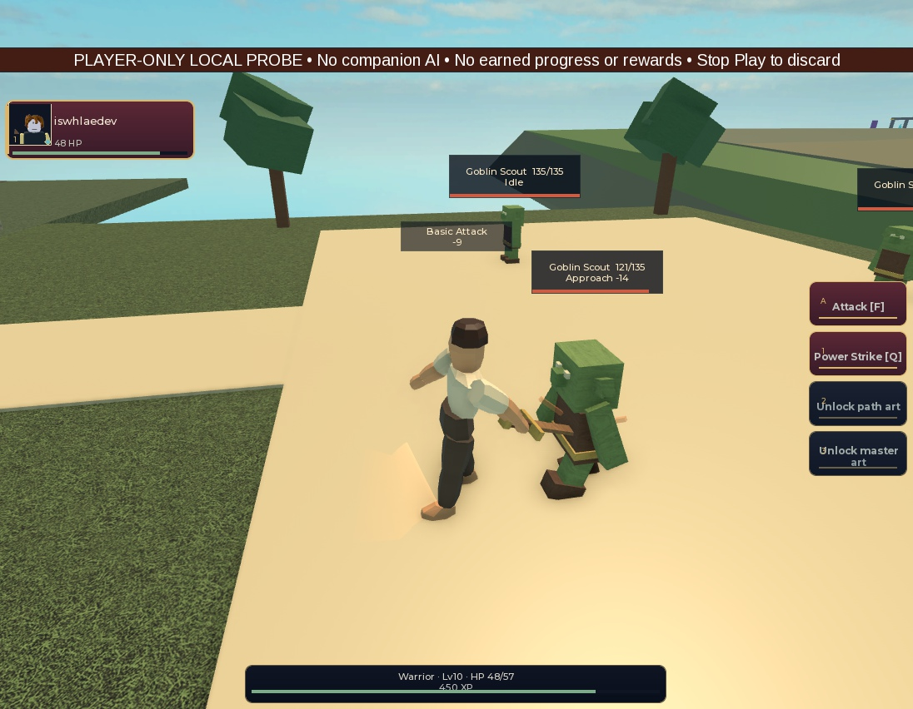

# Human Standard local sword: actual Block contact gate

Final source `c60f44b09493d621f0d71fc2886a8f8833984e76`, following first fit
candidate `0fecd4a702f70ab098c319cca2f4cf9903b7fdfc`.
**The bounded sampled Blade-to-Goblin-body contact, grip-lock, preservation and
cleanup checks pass. Final animation/art and production appearance remain open.**

## Source and exact measurement scope

The controller exclusively used Studio `f291dbaa-f592-422b-adc2-cf15a90e0173`,
the existing unpublished PlaceId0/GameId0 Memory lab. Normal bootstraps stayed
disabled. This is a mixed synthetic fixture, not a complete current-HEAD game.
The player-only fixture independently verifies zero companion models on server,
client and each sampled frame. No Hold/AI-freeze substitution was used.

The original pose's basis conversion was correct; the prior positive-Y sword
fit and choreography pointed the blade too high. LocalWeaponPresentation now
uses fixed fit Rx(pi+.45), preserving socket center and every source dimension.
LocalWarriorBasicPose overrides only Waist, RightShoulder and RightElbow within
the existing fresh-event Human Standard/Warrior/training_sword/Basic gate.
Wrist/root and other injected poses remain unchanged. It uses the existing
ActionTimeline envelopes. No target chasing, stretching, authoritative root
motion, server range/damage/timing/physics changes or gameplay reach changes.
Global ActionPose is unchanged. No production renderer, saves or runtime IDs changed.

LocalContactGeometry measures actual visible Block solids using 15-axis OBB SAT
and minimum vertex/face plus edge/edge distance. Native Goblin1 has14 visible,
direct, unmeshed Block body pieces; invisible root/joint proxies are excluded.
The sampler validates the complete membership and identity every frame and only
observes geometry. Zero separation denotes touching/overlapping solids, including
containment, not penetration depth or coincident boundary surfaces. Floating-point
axis drift up to1e-5 is admitted/repaired; numerical tolerances are documented in
source. The Wedge Point is explicitly unsupported by the contact test. No mesh
bounding box is represented as exact mesh geometry.

Final native readback matches14 SHA256-attributed local modules/dependencies and
both tested fixture sources (16 total). `baseline-source-before-overwrite.json` identifies
the old c4d34cf adapter still used in the first run. The two candidate install
receipts distinguish .35 from final .45; do not use the first install for final
fit attribution. Full source/final state are in `final-edit-source-census.json`.

## Preserved baseline and unsuccessful first fit

The unchanged old pose/identity fit generated270 samples,35 during its active
action. No sampled body-solid overlap occurred. Closest Blade-to-body gap was
0.969238 studs near0.234771s, against the Nose. This confirms an actual visible
body miss; the older2.673-stud root-point distance alone did not establish that.

First candidate .35 fit generated270 samples/35 active samples and11 body-solid
overlap samples, including Tunic at0.237838/0.255620s. It preserved original
equipment and exact cleanup. However,120 walking samples yielded two conservative
Point OBB lower bounds below the queried collidable floor, minimum-0.062732 studs.
This is a conservative clearance failure, not proof of exact wedge penetration.
The fit was adjusted to .45; first-candidate traces and screenshots remain intact.

The first floor query incorrectly included an invisible, noncollidable spawn
proxy with topY2.5 and reported-1.779 clearance. That raw query is preserved as
`candidate-walk-ground.json` and is not accepted floor evidence. The corrected
`candidate-walk-collidable-ground.json` uses RespectCanCollide=true. The final
server receipt documents the excluded proxy's actual properties.

## Final native result

- Walking:120 samples, zero displayed grip center/box separation throughout.
  The Point OBB lower bound clears queried collidable floor in all120 samples,
  minimum+0.014695 studs. These are post-trace static-world ray queries at the
  recorded positions, not exact wedge collision, arbitrary terrain clearance or
  physical-device proof. Raw frame poses and ground hits are retained.
- One existing Basic is sent after explicit synthetic setup relocation3.5 studs
  from Goblin1; the player returns after four seconds. This is not travel proof.
  Server accepts exactly one Basic, BasicAttackCount1/DamageDealt14, with heroes0,
  rewardCallbacks0 and profileWrites0. Enemy AI remains active.
- Final attack:270 samples over4.484 seconds,36 active action samples and12
  sampled overlaps with actual Arm/Tunic/Belt solids. Tunic overlaps at0.235265s
  and0.252989s around the unchanged0.24s contact marker; the latter is inside
  the0.24–0.26 Contact phase. This is sampled contact, not a continuous sweep.
  The action starts once, reaches COMPLETED and does not replay. Grip separation
  remains zero across all270 samples.
- Actual client22-part/five-weld comparison passes mounted and detached. Server
  original weapon identity, five parts, five welds including Enabled, visibility
  and compared physics remain unchanged. The local copy never appears on server.
- Repeated detach restores all16 original body/hair visibility values and all5
  original weapon values, with no restore errors. Pending builds, logical mesh
  references, backings, handles, helper connections and local test models return
  to0. Temporary inspection camera type/subject restore before Stop Play.

This is an actual during-attempt screenshot with a temporary side camera; it is
not a normal-gameplay-camera acceptance test or a generated depiction. No video
was recorded. Screenshots and the timestamped geometry trace are separate evidence.
The faceless source character, garments, block enemy and scene remain unaccepted art.

## Validation and handoff

Independent source review cleared the geometry helper, atomic binding/census,
local fit/profile and final .45 adjustment. Standalone checks execute14 clock/basis,
9 profile and176 geometry assertions. Native geometry execution includes those176
plus5 actual-Part admission/read-only checks (181 total); native weapon policy
checks pass34. The initial combined standalone command only loaded the geometry
test factory; `standalone-geometry-executed.json` and its saved runner contain the
actual176-assertion invocation. No test count is inferred from loading the file.

Full unchanged-source final baseline `85234711c76345fca310ace981817038` passes973
tests,403 strict files and build/sourcemap/repository checks, exit0 in88.626s.
First-candidate receipt `41b4ec142ff64dab8cc7c785dcff1f2a` also passes and is
retained. Raw stdout/stderr remain unchanged; existing GUI harness warnings remain.
Native sampling adds observer overhead (peak final Capture12.748ms); it is a
disposable inspection probe, not production or mobile performance evidence.

Studio is stopped in Edit. Original server/client fixture sources are restored
and fingerprinted, normal bootstraps disabled, runtime lab absent. Local inspection
modules remain available. No paid action, publishing, upload or access expansion.

Next gate is broader visual motion/fit review across supported distances and
orientations, terrain, representative targets and companion motion, before any
production renderer/creator integration. This one3.5-stud synthetic encounter does
not certify all server-eligible distances or full gameplay reach. Faces/hair,
garment fit, gender/other races, animation quality, devices and human signoff remain
open. Keep authoritative mechanics and exact restoration unchanged.

Manifest covers unchanged raw/derived evidence under native and both baseline
folders. It remains REVIEW-only until independent evidence review; no packet can
grant human art/UAT or release acceptance. Fresh quota60% remaining; stop new waves
at30%, no shutdown.
