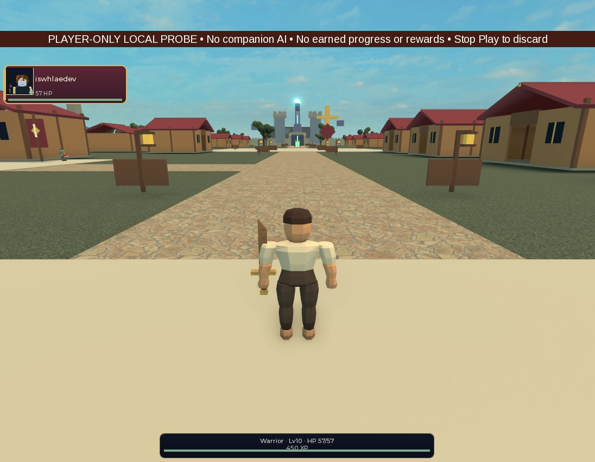
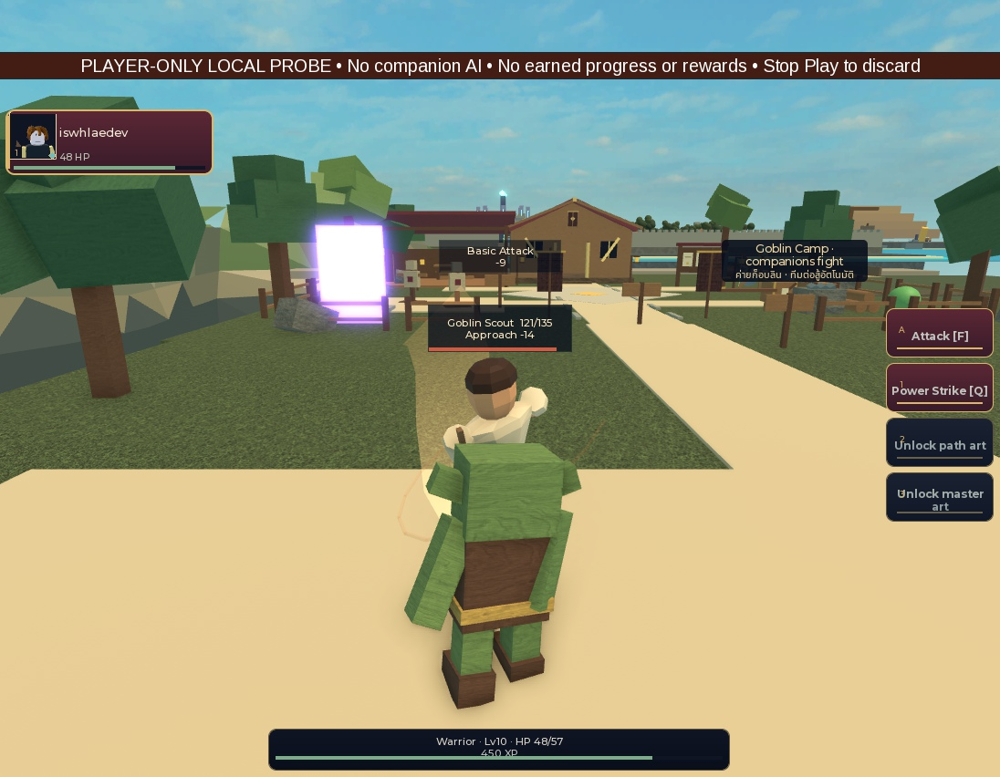

# Local player weapon and action retarget: native bounded result

Candidate `c4d34cf5214cd2deb8c0bc7ede8b04b61824c96a` repairs local weapon/socket
alignment and drives the preview from fresh server-observed Basic events.
**Walking grip alignment, action playback, isolation and restoration pass this
bounded probe. Strike contact and final animation/art remain unaccepted.**
The production renderer, creator, saves, gender/race rollout and runtime asset
IDs are unchanged. No upload, publishing, paid call or production storage access.

## Fixture, source and review

Controller exclusively used Studio `f291dbaa-f592-422b-adc2-cf15a90e0173`,
Guildborne_PartyPresentationLab, PlaceId0/GameId0, Memory persistence and disabled
normal bootstraps. This remains a mixed synthetic lab, not a complete HEAD game
run. Seven installed files match local SHA256-attributed bytes/Adler32 readback;
five unchanged geometry/cosmetic/action dependencies also match. See native
source-attribution, dependency-attribution, install and final-edit-readback files.

Independent source review found that an empty party alone still creates five
Available recruitment heroes. The corrected disposable profile marks the five
canonical recruitment flags while leaving adventurers and party empty. These
flags exist only in the synthetic memory fixture. Server asserts zero hero models
before Ready; client and every probe capture independently verify zero heroes.
Actual server census is zero before and after the encounter. No Hold commands or
AI-freeze switches were used. The reviewer cleared the corrected source.

New LocalWeaponPresentation constructs five fresh, validated training-sword
parts at the source-derived RightGripAttachment. It hides the five original
weapon parts using client LTM only while a valid copy exists. This intentionally
changes the previous gate's local visibility policy; server originals stay
visible. Physics, original welds, item identity and server equipment remain intact.
Unknown or malformed descendants are never cloned or executed.

New LocalActionRetarget consumes the existing injected client ActionPose and
ActionTimeline. It rejects old/future/reordered/unsupported observations and
converts the full pose through the source joint basis. The adapter resets every
joint before walking plus action, preventing accumulation. It does not alter
server hit timing, damage, health, cooldowns or authoritative roots.

## Native observations

- Native weapon policy fixture: 34 named assertions pass, covering exact nonzero
  LTM restoration, replacement, unsupported geometry, unknown scripts, invalid
  welds, lost ownership, copy damage, preview removal, death and repeated cleanup.
- Actual player: 22 original parts and five original WeldConstraints preserve
  compared structure/physics; mounted and detached comparisons report no errors.
  A separate server identity snapshot verifies five original weapon parts and
  five welds, including Enabled; all unchanged. The local copy is absent on server.
- Walking: 120 samples over 5.946 seconds; Humanoid.MoveTo travels approximately
  33.685 horizontal studs out and back according to the adapter's filtered
  distance counter. Displayed grip center and box
  gap to source socket are zero in every sample. The hidden original weapon still
  follows the old hand, with box gap 0.185–2.422 studs, as expected.
- Attack: only the player is relocated as explicit synthetic setup to 3.5 studs
  from the existing Goblin1, then returned by a four-second timer. This is not
  travel evidence. Exactly one existing CombatIntent Basic is sent and accepted;
  server records BasicAttackCount1, DamageDealt14, rewardCallbacks0, profileWrites0.
- Attack trace: 270 samples over 4.477 seconds, including 35 active action samples
  at ages 0.039–0.604 seconds. Display grip gap/center remain zero throughout.
  Shoulder/elbow C0 maximum component differences from the first active sample
  are 1.38249/0.28429, compared
  with zero in the previous failed retarget gate. These are component differences,
  not angular measurements. Action starts once and reaches COMPLETED without replay.
- Detach restores all captured LTM/decal values, including the five weapons and
  16 recognized body/hair parts. Restore failures, helper connections, active
  handles, logical mesh references, backing allocations and remaining local test
  models are all zero. PendingBackingCount was not queried in the first cleanup;
  a separate same-source attach/detach run explicitly verifies pending0,
  references0, backings0 and handles0, exact restoration and repeated-detach
  safety. It sends no attacks. Both original and supplemental raw receipts remain.

## Remaining contact failure

During active action samples, displayed Blade box distance to the recorded target
point is 2.673–4.486 studs; Point box distance is 2.685–4.471 studs. Near the 0.24s
visual contact marker, the closest sampled Blade distance is 2.673 studs at
0.237737s; the 0.253731s sample is 2.682 studs. This demonstrates unresolved
visual reach to the recorded target point. It is not an enemy-surface intersection
test, continuous sweep or accepted natural motion. Grip lock alone does not
establish a convincing hit. No physics or server timing was modified to hide this.

The screenshot shows target 121/135 after the accepted 14-damage Basic; the later
server read after returning to City shows target135 and player57. Do not treat
that later reset state as no hit, a kill, or additional player/companion damage.
Enemy/player AI and normal lab behavior were left running.

No video was recorded. Available Studio MCP exposes still screen capture, not a
native recording operation; local ffmpeg was not found and imageio_ffmpeg/cv2
are unavailable. No recorder was installed. The actual stills and timestamped
trace are motion evidence with these limits, not video or visual/art acceptance.

## Validation, final state and next owner

Fourteen standalone action-clock/basis checks pass. Full unchanged-candidate
baseline `f6cf672caf80467ca48e4f20eb38457b` passes 973 tests, 401 strict runtime
files, compile/analysis, Rojo build/sourcemap and repository checks; exit0,
88.365 seconds, sourceUnchanged true. Raw stdout/stderr remain byte-preserved;
the 2011-byte stderr retains existing GUI harness warnings. These local checks
do not replace the native observations above or device/cross-server acceptance.

Play stopped. Original server/client fixture sources were restored in Edit and
fingerprinted; normal bootstraps remain disabled and the runtime lab is absent.
The new local inspection modules remain installed for further owned inspection.

Next bounded owner: Controller/S15, after claiming/reconciling character-import
and any existing client choreography scope. Review the actual sword orientation,
source joint basis and visual reach around the existing contact marker. Measure
blade/point against actual target geometry in the same zero-companion fixture,
including walking and attack recovery, before accepting motion. Preserve the
server's authoritative timing/equipment and the now-verified cleanup. Do not wire
production appearance or expand gender/races based on this local prototype.

Manifest hashes unchanged raw/derived files under native and baseline. This
packet requires independent evidence review and never grants human art/UAT or
release signoff. Fresh quota: 62% weekly remaining; stop new waves at30%, no shutdown.
