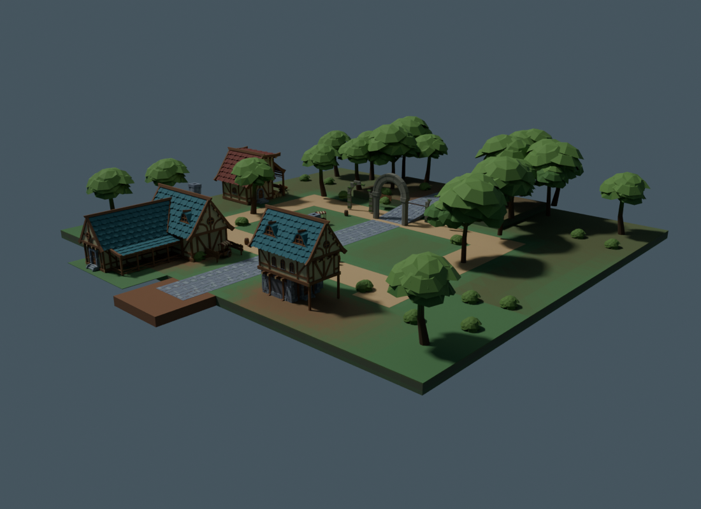
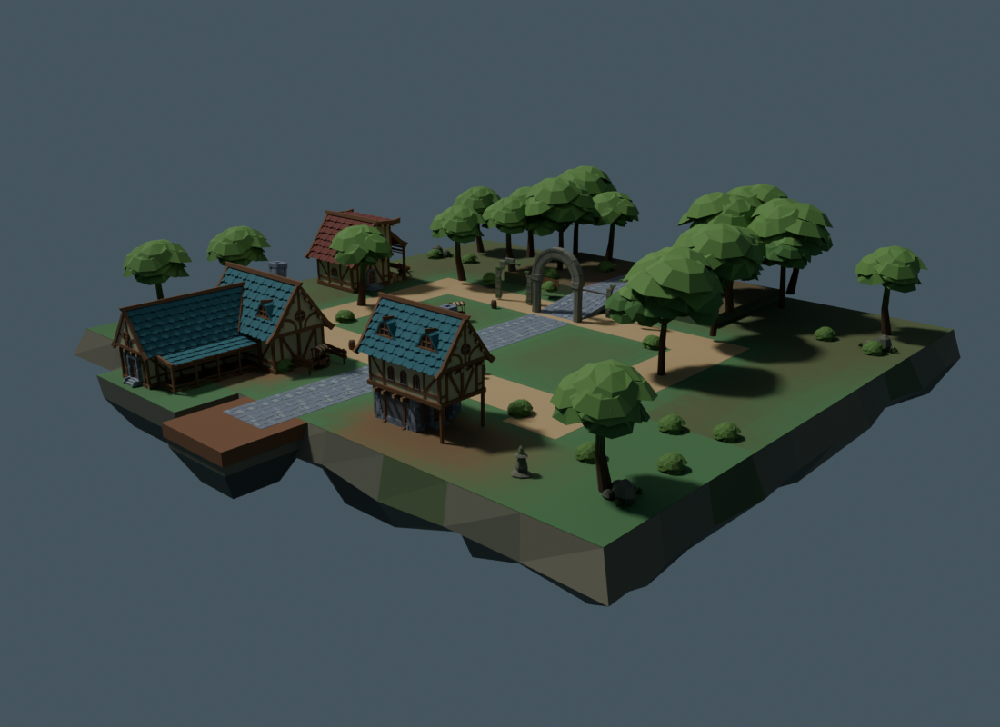
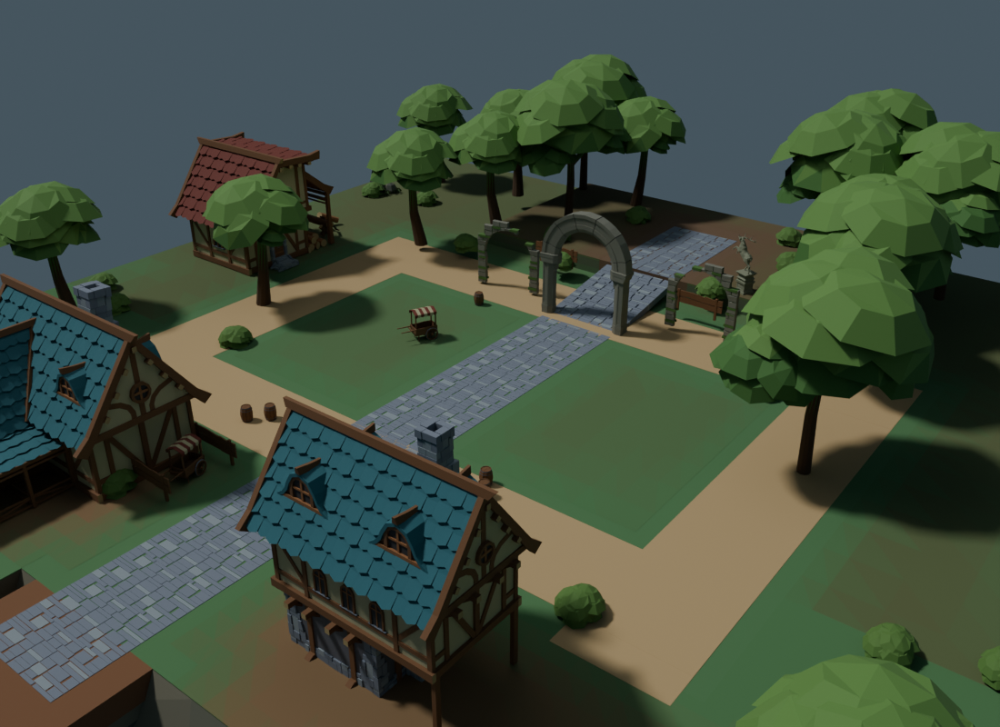
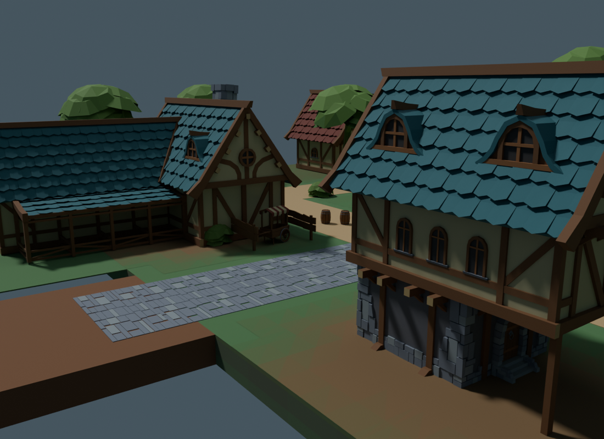
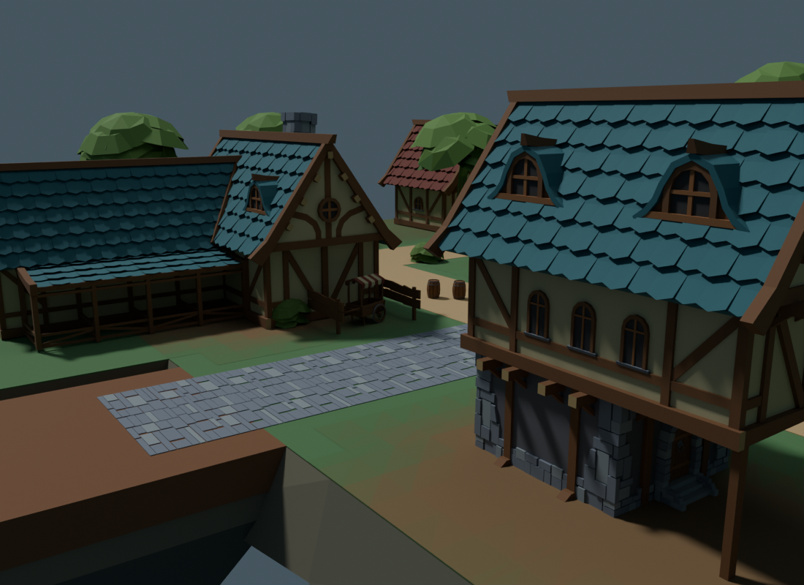

# Greenwood cliff silhouette and arrival edge groups

Source SHA256: `842e1a5e19fdf849117bf17e09485fa532d842022c0186cf60c27bbf09e0d320`.

The previous composition still read as a thin floating board. This pass adds a deep, tapered rock foundation with fractured side bands and separately shaped landing/stable-apron undersides. Four original stone-and-fern groups sit beside existing edge trees; two small ruined jade-stone waymarkers frame the wider arrival courts. Existing buildings, trees, roads, ground skins and gameplay remain unchanged. No random scatter, new runtime service, animation, lights or texture dependency.

## Source and exact cost

The three added resources are original geometry from silhouette_recipe.py. Rock and marker forms use small faceted rings; fern fronds are original double-sided geometry. No additional third-party asset was imported. The original fifteen reviewed CC0 inputs retain their licenses and hashes.

| Metric | Baseline 9909de1 | Current | Added |
|---|---:|---:|---:|
| Mesh resources | 33 | 36 | 3 |
| Placements | 108 | 115 | 7 |
| Unique vertices | 29,678 | 30,163 | 485 |
| Unique triangles | 40,628 | 41,424 | 796 |
| Instanced triangles | 88,888 | 90,622 | 1,734 |
| Colliders | 413 | 413 | 0 |

The added instanced triangle cost is about 1.95%, below this wave's 6,000 ceiling; seven placements are below the ten ceiling. These are static geometry costs, not measured frame time or draw-call counts. All 33 baseline mesh payloads, all 108 placement records and all 413 colliders are retained exactly. Generated expectedArt and source identity change to include the seven additions.

## Comparable actual renders

Both revisions use the same cameras, lens, lighting and native preview stage. Before is the saved 9909de1 blend. These are Blender renders, not Roblox screenshots.

| View | Before | After |
|---|---|---|
| Foundation silhouette |  |  |
| Overview |  |  |
| Low arrival |  |  |

The foundation view shows the strongest change. The low arrival view remains dominated by existing buildings: the wider waymarkers sit outside that framing, while the landing underside now has visible depth. The island retains its existing rectangular playable top and remains a floating island; this pass does not claim seamless mainland terrain or high-fidelity art completion.

## Safety and acceptance

The cliff body stays below native walking height. Its upper ring has no added cap; steep sides taper downward. Main cliff and landing/apron subbases have separately checked envelopes. All new meshes must remain noncolliding, nonqueryable and nontouchable, as the existing preview importer requires. Visible rock beyond the platform is not additional walkable ground; falling beyond the original edge still uses existing recovery and does not land on this decorative foundation. The off-route props have no gameplay interaction.

check_silhouette.py independently compares against git baseline 9909de1, checks full transformed geometry, protected roads/resources/buildings/combat envelopes, foundation volumes/winding and finite two-camera rays against protected anchors and combat samples. These finite samples do not establish visibility from all viewpoints or with dynamic combat effects. Existing terrain checks remain active; silhouette additions have their own validator rather than relaxing terrain support rules.

silhouette-checks.json contains raw local validation outputs; silhouette-clearance.json records geometry/sightline checks; silhouette-renders.json records camera/source/image hashes; silhouette-artifacts.json seals final files and closed logs. Runtime allocation, rendering/backfaces, player-plus-five-hero traversal, telegraph contrast, device performance and human visual approval remain controller/external gates. No Studio work, upload, publish, merge, PR or push occurred in this wave.

Final local result: all checks passed; 824 anchor/combat samples from each of two cameras had zero added-geometry occlusions. Independent read-only review reconfirmed 33 meshes, 108 placements and 413 colliders unchanged, all 272 side triangles outward and all 48 bottom caps downward. It identified an overly permissive winding condition; the checker now distinguishes bottom fans from walls and the full validator rerun passes. The reviewer did not independently rerun visibility; that result is from the recorded local checker.
