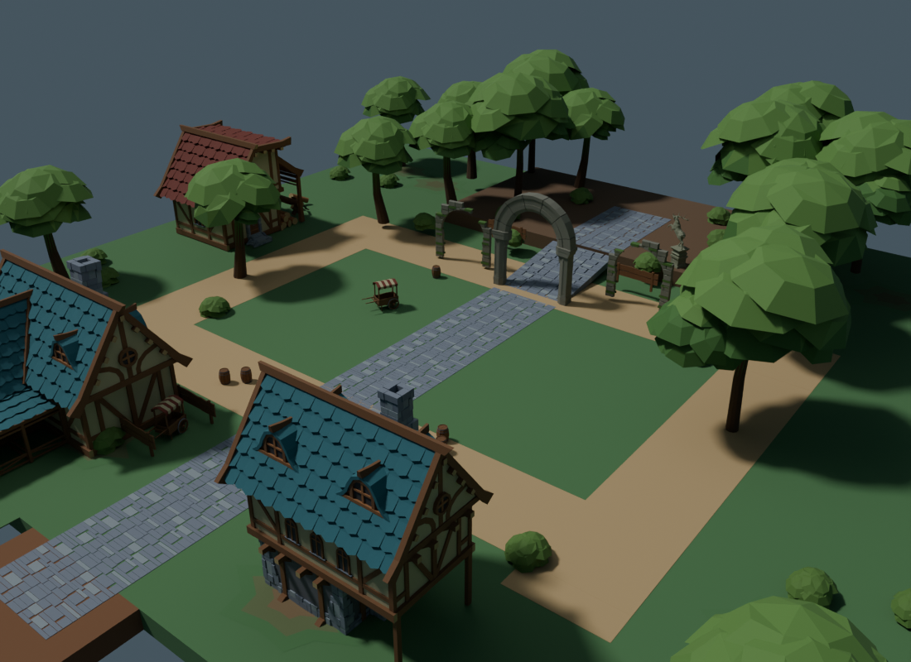
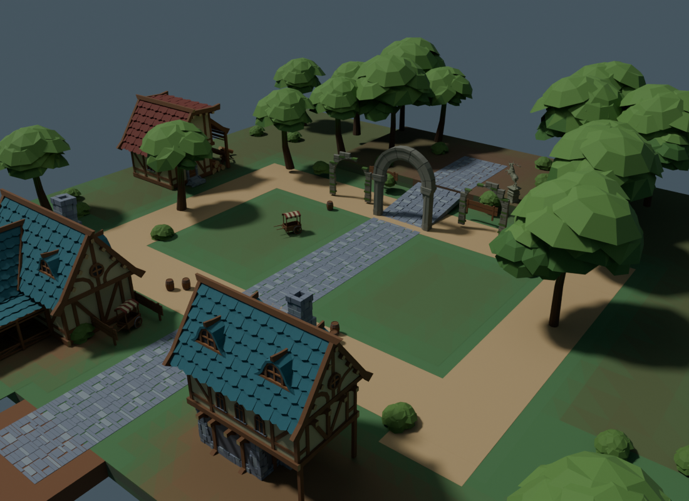
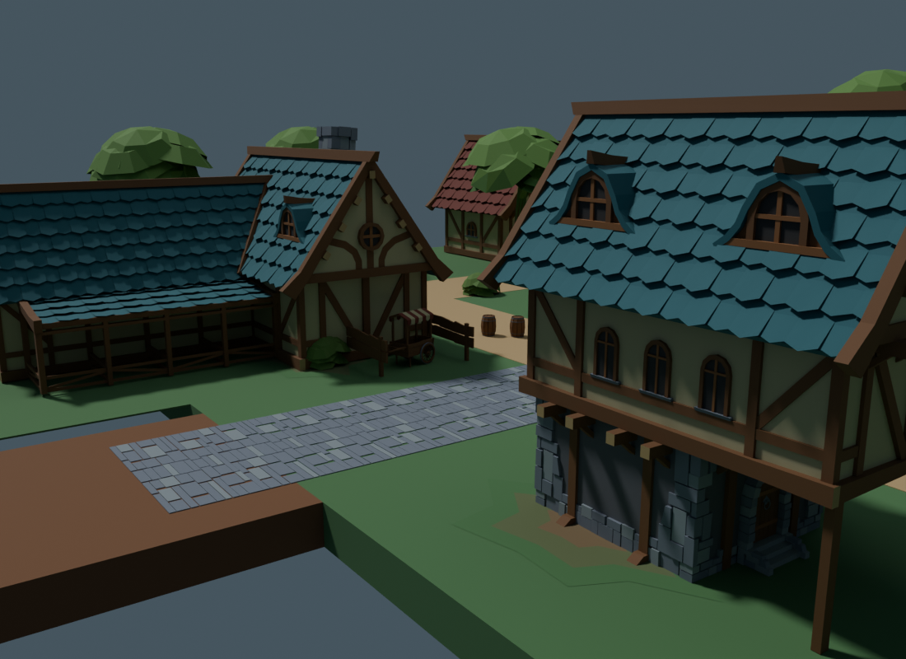
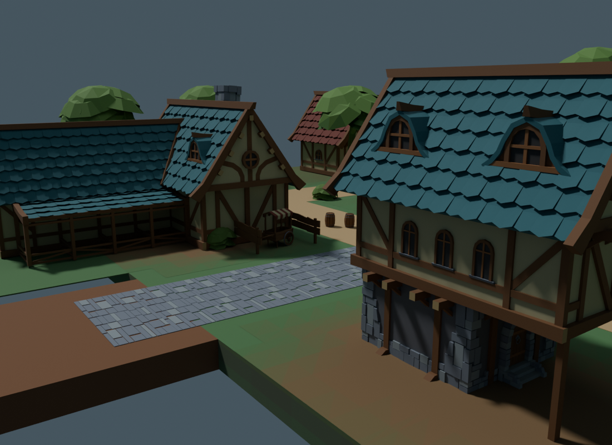
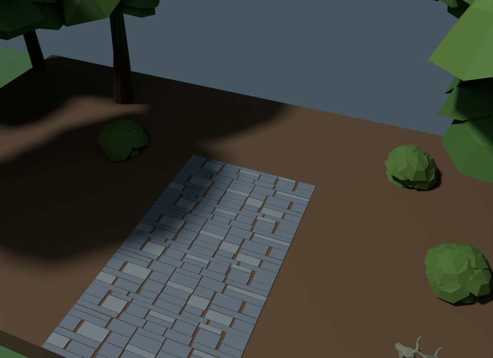
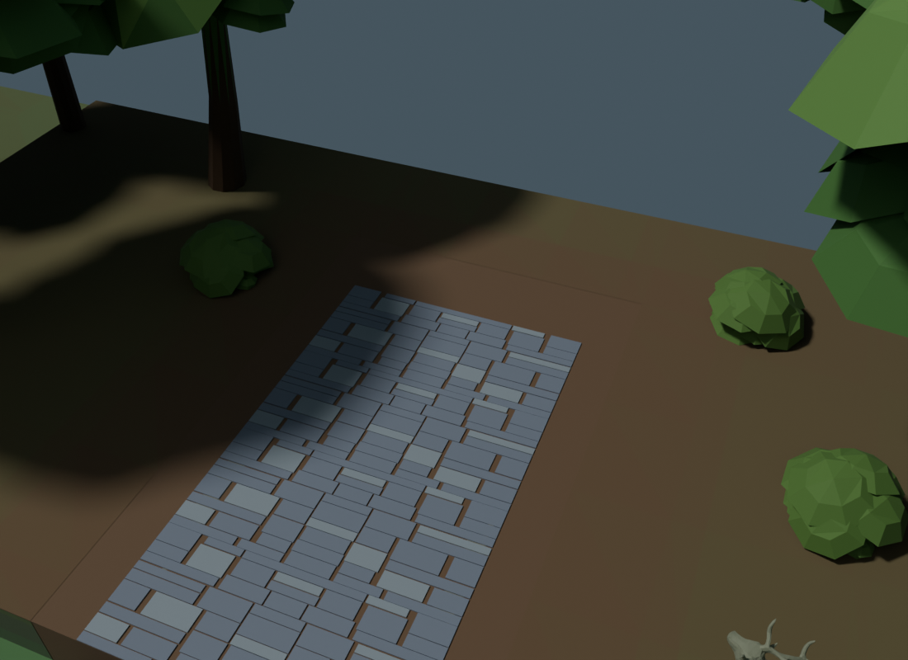

# Connected Greenwood terrain — source review handoff

Current source: `4e0a917e99744fd88740949c55bd549ddedc7844eb03a2df0cdb59a6e50b8a17`.

Replaces ten isolated dirt patches with connected arrival courts, broad forest-floor color regions, a boss-rise surface and exposed soil/rock strata on existing vertical faces. This is original authored geometry and face-color composition; no new catalog assets, textures, providers or runtime IDs. Existing CC0 art retains its intake provenance. The original recipe is terrain_recipe.py.

## Bounded change

- Six new resources and six placements; 3,554 terrain triangles against the 12,000 ceiling.
- Full export: 33 resources, 108 placements, 29,678 vertices, 40,628 unique triangles and 88,888 instantiated triangles.
- Net addition versus 768ae4e is 2,954 instantiated triangles after removing 600 old patch triangles.
- All 27 retained meshes, 102 retained placements (including the 17 edge props), building transforms and 413 colliders are preserved exactly.
- Island top follows Y2.02; boss top follows Y6.02. Road/resource exclusions remain exposed. Side skins follow existing walls, offset by 0.02, with ramp/landing/apron gaps; no new walkable elevation, river, combat rule or collision.

## Actual render comparison

These are Blender source-art renders, not Studio screenshots. Both revisions use identical perspective cameras, 35mm lens, lights and native preview staging. Baseline is the saved 768ae4e blend; the imaginary old preview stream is removed from both and native trail/rise colors shown in both. The terrain remains a bounded floating island under the existing collision constraint.

| View | Before | After |
|---|---|---|
| Overview |  |  |
| Arrival |  |  |
| Boss rise |  |  |

The first boss camera was obscured by pre-existing tree canopies. Those two images remain as terrain-boss-obscured-before/after.png. terrain-renders-first.json is a historical first-render manifest: its original paths/source hash were superseded by later renders. Only terrain-renders.json describes the current comparison; failed framing is not visual acceptance. The final boss palette starts at native brown soil near the protected road cutout, avoiding the earlier abrupt grass/brown boundary.

## Verification and remaining acceptance

check_terrain_composition.py independently checks triangle-plane support and projected triangle/rectangle clipping (including crossings with no vertex inside), normals, road/resource exclusion, sidewall bounds, attachment gaps, exact baseline hashes and budget. terrain-clearance.json contains the current result; terrain-props-clearance.json retains the 17-prop envelope checks. These are geometry checks, not dynamic telegraph or all-camera visibility proof.

terrain-checks.json preserves actual raw stdout/stderr for Python compilation, offline geometry/clearance, clipping self-test, controller import-schema validator, 28 Luau contracts, 19 mocked service lifecycle checks and generated Luau compilation/analysis. No fresh whole-game suite or Studio/device pass is claimed. terrain-authoring.json and terrain-artifacts.json record identity and closed artifact/log hashes.

Controller must import the exact source together with collision.json/WorldQualityAssets, measure full preview allocation and rendering, check telegraph contrast at each encounter, walk player plus five heroes through the region, and review lower-angle wall/edge joins. Physical-device performance and human art approval remain external. This pass improves surface composition; it does not establish final high-fidelity terrain or all-world completion.
